# Unit Test Agent

This repository extends Taskly with a TypeScript tool-calling agent that inspects
application changes, selects reusable skills, proposes behavioral unit tests and
reports an evidence-based decision. Generated tests remain reviewable artifacts;
the workflow does not push commits to a developer's branch.

## Architecture

```mermaid
flowchart LR
    PR[Pull request] --> Checks[PR checks: no AI secrets]
    Checks --> Gate[Trusted workflow_run context gate]
    Gate --> Agent[Trusted agent + DeepSeek]
    Agent --> Proposal[Proposed tests and structured report]
    Proposal --> Validation[Separate runner: no AI secrets, read-only token]
    Validation --> Artifact[Coverage, logs and tests.patch]
    Artifact --> Report[Separate PR reporting job]
```



The existing application uses React, React Query, Express and Prisma. Both suites
use Vitest; frontend tests use Testing Library and backend HTTP tests use Supertest.
The agent therefore uses the existing frameworks and a small explicit loop around
the established OpenAI TypeScript SDK. There is no additional agent framework,
database, OpenAI credential or AI subscription. Only DeepSeek API usage is billed.

`agent/src/llm.ts` contains the DeepSeek-specific SDK configuration. A single
`LanguageModel.complete` interface makes the loop testable and allows another
compatible provider without introducing an adapter framework.

### DeepSeek compatibility

Verified against official documentation on **24 November 2026**:

- [First API call](https://api-docs.deepseek.com/): OpenAI TypeScript SDK,
  `baseURL: https://api.deepseek.com`, `DEEPSEEK_API_KEY`.
- [Chat completions](https://api-docs.deepseek.com/api/create-chat-completion/):
  `deepseek-v4-pro`, function tools, `max_tokens` and usage fields.
- [Thinking mode](https://api-docs.deepseek.com/guides/thinking_mode/): when tools
  are present, all prior assistant `reasoning_content` must be replayed, including
  assistant turns without tool calls.

The implementation retains the **entire assistant message** in memory and sends
it back unchanged. It never writes the conversation or private reasoning to logs,
artifacts or PR comments. The adapter explicitly enables thinking; the default
effort is `low`. The SDK's narrower effort enum requires one cast at the provider
boundary for DeepSeek's documented `max` value. A mocked HTTP test exercises the
real SDK's request serialization and reasoning-field preservation.

Documentation compatibility is verified. A live authenticated model execution
is recorded separately when available; mock tests are not evidence of a live run.

### Repository structure

| Location | Purpose |
|---|---|
| `frontend/`, `backend/` | Existing application and Vitest suites |
| `agent/src/agent.ts` | Bounded tool loop, dispatch, decision/validation state |
| `agent/src/llm.ts` | DeepSeek SDK boundary and bounded transient retry |
| `agent/src/safety.ts` | Source-read policy, proposal schema and path checks |
| `agent/src/runner.ts` | Optional local Docker test execution |
| `agent/skills/*.md` | Independently defined reusable skill instructions |
| `agent/tests/` | Deterministic orchestration, SDK, policy and runner tests |
| `agent/scripts/validate.mjs` | Separate CI baseline/proposal validator |
| `.github/workflows/` | Ordinary PR checks and trusted agent pipeline |
| `docs/evidence/` | Actual baseline and improved coverage/test output |

### Skills and tools

The trusted skill catalog is exposed to the model. It chooses `invoke_skill` to
load `analyze-pr`, `identify-gaps`, `frontend-tests`, `backend-tests`,
`update-tests`, `validate-tests`, `repair-tests` and `report` as needed. Loading is
recorded in the public report, and the harness enforces prerequisite skills.
Skills live outside the application and can be reused across local and PR runs.

Typed Zod contracts generate JSON tool schemas and validate incoming arguments.
Available tools are `list_files`, `read_file`, `analyze_diff`, `read_coverage`,
`write_test`, `run_tests`, `invoke_skill` and `finish`. There is no arbitrary shell
or network tool. Test proposals are staged in memory rather than applied to the
checkout during generation. The model may finish with `no-test-changes`; the
harness rejects that decision if files were staged.

`run_tests` uses Docker locally with `--execute`. In the secret-bearing CI
generation job it returns **deferred**. That result never becomes a passing
validation claim. CI then applies the proposal and runs actual baseline and
proposed suites in a different job. Local validation failures can be fed back
through `repair-tests` up to three test executions and the overall run budgets.
CI publishes failures for review; it does not automatically start another paid
repair run.

## Setup and execution

Use Node.js **22.12+** (CI uses Node 22). PostgreSQL is unnecessary for unit tests.

```sh
npm --prefix frontend ci
npm --prefix backend ci
npm --prefix agent ci
```

Copy `.env.example` to `.env` and privately set `DEEPSEEK_API_KEY`, or export it
in the invoking shell. Do not paste a key into commands that will be recorded.
The root `.env` is ignored. The agent does not automatically load configuration
from the source checkout, because PR-owned environment files are untrusted.

Run from the repository root with a local `.env`:

```sh
node --env-file=.env agent/node_modules/tsx/dist/cli.mjs agent/src/cli.ts \
  --root . --out .agent-output
```

Inspect a PR using full immutable commit SHAs:

```sh
node --env-file=.env agent/node_modules/tsx/dist/cli.mjs agent/src/cli.ts \
  --root . --base "$BASE_SHA" --head "$HEAD_SHA" --out .agent-output
```

Default execution generates proposals and marks validation deferred. For local
execution, build the trusted sandbox image and add `--execute`:

```sh
docker build -f agent/Dockerfile.validation -t taskly-test-validation .
node --env-file=.env agent/node_modules/tsx/dist/cli.mjs agent/src/cli.ts \
  --root . --out .agent-output --execute
```

The sandbox image installs locked dependencies at build time. Execution has no
network, host credentials or writable host source mounts. After reviewing a
proposal, apply only its approved tests:

```sh
npm --prefix agent start -- --root .. --apply ../.agent-output/proposal.json
```

The apply command validates all paths before writing. Applying is not validation;
run both suites afterward. CI also exports a standard `tests.patch` artifact.

Without live API calls:

```sh
npm --prefix frontend run test:coverage
npm --prefix backend run test:coverage
npm --prefix agent run test:coverage
npm --prefix frontend run typecheck
npm --prefix backend run typecheck
npm --prefix agent run typecheck
```

The deterministic agent tests simulate selected skills, a documentation-only
no-change decision, test generation/staging, failed validation, repair and rerun,
stale validation rejection, malformed/unknown tools, credential-read denial,
reasoning retention, budget exhaustion and provider failures. All LLM responses
are mocked. Docker process behavior is mocked in unit tests as well.

### Configuration and usage reporting

| Variable | Default | Purpose |
|---|---|---|
| `DEEPSEEK_API_KEY` | required for live runs | Local environment / GitHub secret |
| `DEEPSEEK_MODEL` | `deepseek-v4-pro` | DeepSeek model selection |
| `DEEPSEEK_REASONING_EFFORT` | `low` | `low`, `high` or `max` |
| `AGENT_MAX_ITERATIONS` | `24` | Maximum model turns (ceiling 100) |
| `AGENT_MAX_OUTPUT_TOKENS` | `8192` | Per-response output/reasoning budget |
| `AGENT_MAX_TOTAL_TOKENS` | `160000` | Cumulative reported input/output budget |
| `AGENT_MAX_CONTEXT_BYTES` | `180000` | Reject oversized retained context |
| `AGENT_API_TIMEOUT_MS` | `90000` | Timeout per API attempt |
| `AGENT_TEST_TIMEOUT_MS` | `120000` | Local sandbox execution timeout |

The context guard uses UTF-8 bytes as a conservative token upper bound and
reserves output before making another request. It fails instead of truncating
reasoning. Up to eight tools can be called in one model response. Tests run at
most three times. The SDK has automatic retries disabled; the adapter retries
429/5xx once with a delay. Authentication and validation failures are not retried.
The report contains logical requests, input/output/total tokens and cache hits.
Unknown provider-side charges from failed attempts cannot be recovered from an
absent response. This is a bounded usage policy, not a precise currency spending
cap; use DeepSeek account controls for a monetary limit.

## Verified coverage improvements

Baseline: original commit `22be6e3`. The same application coverage configuration
and thresholds were retained. No original tests were weakened or removed.

| Suite | Tests before → after | Statements % | Branches % | Functions % | Lines % |
|---|---|---|---|---|---|
| Frontend | 18 → 34 | 46.42 → 66.07 | 43.79 → 53.28 | 40.25 → 62.33 | 47.68 → 66.22 |
| Backend | 48 → 64 | 30.23 → 65.11 | 33.33 → 81.25 | 40.62 → 71.87 | 33.02 → 66.05 |

The new application regression tests are **engineer-authored**, not represented
as DeepSeek-generated. They cover malformed/oversized JSON, private error
containment, task lookup/update/delete and invalid inputs, HTTP error messages,
request cancellation and actual React Query cache behavior. Live agent-generated
improvements and demo execution are recorded separately when credentials permit.

See `docs/evidence/baseline-*.{json,txt}` and `after-*.{json,txt}`. Log paths are
normalized for portability; coverage numbers are unchanged. Both application
typechecks and production builds passed locally. The 39 deterministic agent tests pass. Agent test evidence is in
`docs/evidence/agent-tests.txt`. The initial main-branch [PR checks run](https://github.com/maxikgreat/taskly-unit-test-agent/actions/runs/45477775540) passed. The actual Docker sandbox also passed both application typechecks and all 98 application tests; see `docs/evidence/sandbox-smoke.txt`.

## GitHub Actions

`PR checks` runs tests, coverage and typechecks without AI secrets for all PRs,
including forks. `Unit Test Agent` runs from the default branch after successful
PR checks. It looks up the current PR through GitHub's API, verifies the immutable
head and allows generation only for an open, same-repository PR. Closed, stale
and fork PRs do not receive a secret-bearing run.

The generation job checks out trusted agent code from the default branch and PR
source separately. Only the trusted agent's lockfile is installed, with lifecycle
scripts disabled. It never installs PR dependencies, imports PR code, or executes
PR tests. Existing coverage artifacts are read as bounded untrusted JSON.

The separate validation job has no DeepSeek key, no write token and no persisted
checkout credentials. It installs PR dependencies, measures baseline coverage,
applies the trusted path policy, typechecks and tests both suites, checks that
only approved files changed, and exports the patch and evidence. Reporting runs
on a third runner; it only reads bounded artifacts and posts/updates a bot comment
if the PR head still matches. All privileged JS is static workflow code. No PR
description, branch name or generated text is interpolated as executable code.

The validator imports its policy and retains the checked proposal before running
any PR scripts. It rejects test content changed during execution. Deterministic
tests simulate scripts replacing the proposal or altering staged tests to verify
these boundaries; command simulation is not counted as application execution.

Configuration:

1. Put this implementation on the independent repository's default branch.
2. Add `DEEPSEEK_API_KEY` as a GitHub Actions secret, preferably in the
   `test-agent` environment. Never put it in a workflow file or repository variable.
3. Optionally set the `DEEPSEEK_MODEL` repository variable.
4. Restrict the `test-agent` environment to the default branch; add a reviewer
   when approval of paid API usage is desired.
5. Enable Actions and allow the reporting job's scoped PR write permission.

No personal access token or branch-write bot is required. GitHub's built-in token
is sufficient. A workflow must exist on the default branch before its
`workflow_run` trigger is active. Reports link to logs, the proposal and the patch.
The no-test case produces an empty proposal/patch and a clear no-change decision.
The separate validator still runs the existing suites.

## Security model and limitations

- Source, tests, diffs, coverage and generated output are untrusted data. Prompt
  instructions alone are not a security boundary. Tools enforce readable paths;
  `.env`, Git configuration, generated files and arbitrary files are unavailable.
- Only `frontend/src/**/*.agent.test.ts(x)` and
  `backend/tests/**/*.agent.test.ts` may be written. This permits updates to
  previously generated tests while protecting human-owned tests. All paths are
  relative, normalized and checked for symlink parents/files. Proposals have
  bounded file counts/sizes and reject duplicate paths and obvious test bypasses.
- Content checks are defense in depth, **not a JavaScript sandbox**. CI executes
  code in a separate ephemeral GitHub runner without valuable secrets. That runner
  has network access for dependency installation. Local Docker execution disables
  network and drops privileges/capabilities. Tests can still lie about behavior;
  patches and coverage need human review.
- Coverage from PR configuration is informational and can be manipulated by PR
  code. A green command does not prove semantic correctness or non-maliciousness.
- The original untested server lifecycle/process-exit paths remain outside the
  current improvements. The agent cannot fix production bugs or protected tests;
  it must report those limitations.
- Context, diff, file and tool-call limits can reject large changes. No silent
  truncation or fallback provider is used. Missing usage, truncated model output,
  exhausted iterations or validation failures produce failure, not success.
- Credential values are never included in prompts intentionally. Known local
  credentials and common token patterns are redacted from public output. Raw
  provider errors and transcripts are not logged. Do not put credentials in source.
- Dependency audit findings inherited from locked application packages were not
  automatically upgraded: changing the dependency tree would expand this task.
  Production work should review those advisories, pin the Docker base by digest,
  add outbound allowlisting and stronger per-run monetary accounting, and isolate
  installation/execution in disposable VMs with no runner control channels.

The working assumption is that the default branch and its agent dependencies are
trusted, while every PR may be hostile. The workflow uses no `pull_request_target`,
performs no automatic merges and makes no application-branch commits.

## Delivery and remaining live setup

Repository: [maxikgreat/taskly-unit-test-agent](https://github.com/maxikgreat/taskly-unit-test-agent).

Demonstration: [PR #1 — priority filtering](https://github.com/maxikgreat/taskly-unit-test-agent/pull/1).
The feature adds a priority dropdown alongside status/search/sort and a validated
optional priority query on the listing API. Existing tests and typechecks pass.
The [PR checks run](https://github.com/maxikgreat/taskly-unit-test-agent/actions/runs/45478559978)
passed for all three suites. The
[agent workflow](https://github.com/maxikgreat/taskly-unit-test-agent/actions/runs/45478687210)
failed at the missing-key guard, skipped generated-test validation, and
[posted its actual failure report](https://github.com/maxikgreat/taskly-unit-test-agent/pull/1#issuecomment-7143251846)
with zero API requests. Context checks, coverage-artifact downloads and the
separate reporting job completed successfully. No live no-test-change PR was
run; that decision path is demonstrated in mocked orchestration tests.

No live DeepSeek calls were made: the API key was unavailable and live execution
was explicitly deferred. This means autonomous generation, live API reasoning
retention and a completed agent PR report have not yet been verified against a
real model. The mocked SDK and orchestration tests do not substitute for that
evidence. Missing-key executions export a clear failure report with zero API
requests; the workflow never claims successful generation.

Add the secret using GitHub Settings → Environments → test-agent, or run the
following interactive command (do not place the secret in a command argument):

```sh
gh secret set DEEPSEEK_API_KEY --repo maxikgreat/taskly-unit-test-agent --env test-agent
```

Then rerun the failed `Unit Test Agent` workflow for the demo PR. Download and
review the proposed tests and `tests.patch`, inspect actual validation and coverage,
and apply the patch only after reviewing it. GitHub reporting uses the built-in
Actions token; no additional AI subscription is needed.
